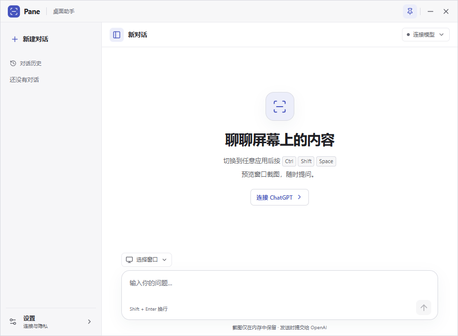

# Pane · Windows 桌面助手

Pane 是一款 Windows 桌面 AI 助手。切换到目标应用后，可以用浮动角色或全局快捷键唤出聊天，直接针对窗口画面、选中的文字或语音提问。桌面指导会在右上角显示操作步骤，并在目标窗口上高亮相关控件。

## 39 秒产品演示

主窗口收起后，点轨道机器人打开迷你聊天。一键截取正在用的窗口，预览后直接问，免保存、免导入。也可以在其他应用里划词，随时翻译、解释或追问。

https://github.com/user-attachments/assets/e4d62571-25f8-437b-b1cc-7a00d160b7d3

[下载 1080p MP4](https://github.com/t0mAto1104/pane-desktop-companion/releases/download/v3.5.0-voice.5/Pane-Product-Trailer-39s.mp4) · [查看封面](docs/Pane-Trailer-39s.png)

## 下载

适用于 **Windows 10/11 x64**。安装包未签名。

- **最新预览版 · 3.5.0-voice.5**　采用「折窗」新标志，包含自动划词、麦克风试录和本地 Whisper 转写。[下载安装包](https://github.com/t0mAto1104/pane-desktop-companion/releases/download/v3.5.0-voice.5/Pane-Setup-3.5.0-voice.5-x64.exe) · [版本说明](https://github.com/t0mAto1104/pane-desktop-companion/releases/tag/v3.5.0-voice.5)
- **稳定版**　包含浮动聊天、窗口截图问答和桌面指导。[查看最新稳定版](https://github.com/t0mAto1104/pane-desktop-companion/releases/latest)

## 主要功能

- **窗口问答**　按 **Ctrl+Shift+Space** 唤出 Pane。预览单个窗口的截图后再发送，也可绑定窗口，让 Pane 在本机观察界面变化。
- **自动划词**　在「设置 → 全局划词」开启。在支持的应用里选中文字，悬停小图标即可翻译、解释或问 AI。
- **离线语音转写**　在「设置 → 语音」试录并回放，首次下载约 190 MB 的 Whisper 模型后即可本地转写。确认草稿后再发送。
- **桌面指导**　在目标窗口上高亮控件，把当前操作步骤显示在屏幕右上角。实际点击和输入由你完成。

聊天可通过符合条件的 ChatGPT 账户或独立 OpenAI API Key 连接。语音转写在设备上完成。截图和文字在你确认发送后才提交给聊天服务。

| 浅色 | 深色 |
| --- | --- |
|  |  |

## 浮动助手

默认在 Windows 桌面右下角显示轨道机器人。点击角色可打开迷你聊天，再点角色或按 **Esc** 收起。拖动角色下方的小横条可移动，位置会在重启后恢复。角色显示在聊天主窗口收起时，迷你聊天打开后仍可点击角色将其收起。

- 切换到要截取的应用，再点角色。点击 **截取窗口** 获取已绑定的窗口或打开角色前的前台窗口。也可以从迷你聊天中的窗口菜单选择目标。
- 确认预览后可以带图提问，也可移除截图后发送纯文字。迷你聊天只附上本轮手动截取的图片。
- 点击 **展开主窗口** 可回到完整对话历史。点击 **桌面指导** 可打开指导面板。
- 在 **设置 → 窗口与外观** 切换 **轨道机器人**、**灯笼狐** 或 **苔云**。可通过设置或托盘菜单关闭及恢复浮动助手。

## 安装与使用

1. 在 Windows x64 运行下载到的 Pane 安装程序。安装包未签名。
2. 点击角色后打开 **连接模型**，在 **设置 → 账户和模型** 选择 **使用 ChatGPT 登录**，在系统浏览器中允许使用 ChatGPT 套餐额度，再从账户返回的目录选择支持图片的模型。符合条件的账户才会获得套餐用量权限。
3. 切换到目标软件，按 **Ctrl+Shift+Space** 唤出 Pane。检查窗口名称和截图预览，然后输入问题并按 **Enter**。按 **Shift+Enter** 换行。
4. 通过输入框上方的窗口菜单绑定另一个窗口，用刷新按钮更新截图。可在预览中取消附件。用标题栏图钉切换置顶，拖动标题栏移动窗口，拖动边缘缩放。
5. 按 **Esc** 或点击隐藏按钮返回托盘。托盘菜单可以退出 Pane。在设置中可切换深色或浅色、关闭唤出时抓图、配置要禁止捕获的 `.exe` 文件名。

使用 API Key 时，在 **连接方式** 选择 **OpenAI API Key**，打开 Windows 原生输入框并输入密钥。这个模式使用独立的 OpenAI Platform 项目额度。应用会查询该项目的模型目录。发送截图时请选择支持图像输入的 Responses 模型。

## 屏幕感知

1. 在输入框上方打开 **屏幕感知**，再通过窗口菜单绑定要观察的窗口。也可以先绑定再启用。
2. 状态栏显示窗口名称、最近观察时间和变化比例。可预览观察截图，暂停或恢复监控。
3. 自动模式优先使用明确附加的手动截图，其次是最新有效观察。画面持续变化或观察暂不可用时，可对同一个窗口做一次限时捕获。采集失败会保留草稿，提供重新截图或明确改为仅发送文字的选项。
4. 取消勾选 **发送时使用最新屏幕观察** 后，可发送文字或明确选择的手动附件。在观察预览里选择 **本条附上观察截图** 会要求使用有效观察，缺少图片时会提示。输入框显示本轮计划和已发送请求的实际来源。
5. 同一张缓存截图可为多个新问题提供独立视觉依据。静态观察复用内存中的 JPEG。历史聊天继续提供文字上下文，旧图像不会随文字请求上传。

| 设置 | 默认 | 范围 |
| --- | --- | --- |
| 屏幕感知 | 关闭 | 开或关 |
| 采样间隔 | 1000 毫秒 | 350–5000 毫秒 |
| 变化阈值 | 0.015（1.5%） | 0.002–0.5 |
| 最近观察数量 | 3 | 1–8 |

观察进程复用一个 WGC 会话，以 96 × 54 彩色采样在本地比较画面。确认变化后才生成 JPEG。防抖要求连续采样趋于稳定，持续变化的界面达到等待上限后可采纳当前画面。两次已记录变化之间至少相隔 1.5 秒。图片缓存在内存，另有 24 MiB 上限。只有显式打开预览时，主进程才把一张观察图片交给界面。观察标识、窗口名称和与对话的推理关联保存在内存。使用观察图片的消息在 SQLite 中以「屏幕观察」标记，消息结构延续 V1。用户发送前，观察过程没有推理调用。

监控可以在托盘后台继续运行。暂停、关闭功能、解绑、锁屏和系统挂起会释放观察会话和缓存。最小化、失效、禁止捕获或原生错误均会停止观察。锁屏、暂停、禁捕和窗口身份失效会阻止自动捕获。窗口还原后可恢复，重新打开窗口或重启 Pane 后须重新绑定。捕获失败或画面仍在确认时，可以继续发文字。手动刷新截图仍可使用。屏幕感知通过 WGC 在本地观察像素。细微文字或变化区域小于阈值时，可降低阈值或手动刷新。Windows 旧版本的 WGC 会话可能持续供应合成帧，Pane 仍按设定的间隔读样。


## 全局划词

在设置中开启自动划词，选中文字后悬停小图标即可翻译、解释或直接提问。也可使用 **Ctrl+Shift+Q**。选区识别不调用 AI。 [实现与接口](docs/global-text-selection.md)

## 语音提问

在「设置 → 语音」下载本地 Whisper 模型，也可以先试录并回放。点击聊天框麦克风，等到录音就绪后说话。转写在本机完成，确认后再发送文字。[使用说明](docs/voice-mode.md)

## 桌面指导

生成步骤后，控制面板收起，当前步骤出现在目标屏幕右上角。任务栏不接收鼠标或键盘操作。用浮动角色或托盘菜单 **打开桌面指导** 检查结果、切换步骤或退出。关闭面板会保留当前任务。

选择目标窗口后，点击 **桌面指导**。可在预览中框选局部、按名称定位控件、切换到真实窗口查看高亮，或输入任务生成教学步骤。Pane 会在用户要求时检查预期控件是否出现，证据不足时由用户手动确认。每一步实际操作由用户亲自完成。视觉定位和教学要附带图像时，需要为该次提交单独授权。[使用说明与接口](docs/desktop-guidance.md)

## 数据与权限

- Windows.Graphics.Capture 按 HWND 捕获单个窗口。助手窗口会被排除。最小化、受保护、已关闭或身份无法确认的窗口可能无法捕获，应用会在截图区域显示原因。
- 发送前可检查或取消待发送的截图。已发送的截图在内存里用于后续同一对话，退出 Pane 或达到缓存上限时清除。每次请求最多附上本轮选定的一张截图，同时携带最近 60 条范围内、总计约 10 万字符的历史消息文字。跨重启保留消息文本、对话更新时间和已发送截图的窗口标题。截图像素仅在内存中保留。
- 对话、设置和加密的 API Key 位于 `%APPDATA%\Pane\pane.sqlite`。OAuth 凭据由 DevKit 保存在 `%APPDATA%\Pane\chatgpt`，使用 Windows DPAPI 保护。密钥和令牌由主进程与本机凭据输入框处理。
- 两种连接都使用公开的 `https://api.openai.com/v1/responses`，每次发送 `store: false` 和 `stream: true`。请求携带相关本地历史。截图和消息在发送时交由 OpenAI 处理。桌面指导在用户发起时使用相同连接，教学状态与界面控件数据仅保存在会话内存。

## 从源码构建

目标平台为 Windows 10 x64（版本 1903 或更新）及 Windows 11 x64。需要 Node.js 24.13 或更新版本、npm、Visual Studio 2022 的 **使用 C++ 的桌面开发** 组件，以及含 C++/WinRT 头文件的 Windows SDK（构建已使用 10.0.26100）。

```powershell
npm ci --legacy-peer-deps
npm run build:native
npm run build:whisper
npm run dev
```

```powershell
npm test
npm run build
npm run test:desktop
npm run test:desktop:guide
npm run test:desktop:companion
npm run test:desktop:account
npm run dist:win
node tests/desktop.mjs --packaged
node tests/ui-desktop.mjs --packaged
node tests/companion-desktop.mjs --packaged
```

安装包输出到 `release/`，文件名包含当前版本号。桌面测试会打开一个专用的模拟交易窗口，并向该窗口发送快捷键。它验证截图像素、刷新、绑定、多轮流式 UI、停止、重发以及 SQLite 重启恢复。AI 响应由本地测试替身提供。自动化也覆盖两种 Responses HTTP 流，以及模拟 OAuth 回调、凭据轮换和模型发现。

本次验收使用本机 Windows 构建 26300、单显示器、100% DPI。桌面测试覆盖窗口缩放、观察启停、禁止名单、窗口重开、动态行情即时捕获、锁屏事件模拟、截图竞态和显式发送。单元测试覆盖 DPI 变化评分。账户登录、真实图片推理、独立 Windows 10、多物理显示器及混合 DPI 实机矩阵需要在覆盖相应环境时验证。OAuth 测试可在安装包中使用有资格的账户授权，然后切到专用窗口发送一张测试截图，再追问截图中的细节。

## 官方接入与许可

OAuth 使用固定版本的 Sign in with ChatGPT DevKit。仓库内保留其源码、修改说明和许可证。随附 DevKit 采用 OpenAI 非商业许可证，本地个人 MVP 按该许可交付。商业使用需适用的书面许可。[OpenAI 官方接入指南](https://developers.openai.com/cookbook/articles/sign-in-with-chatgpt) · [DevKit 许可证](./vendor/siwc/LICENSE)
