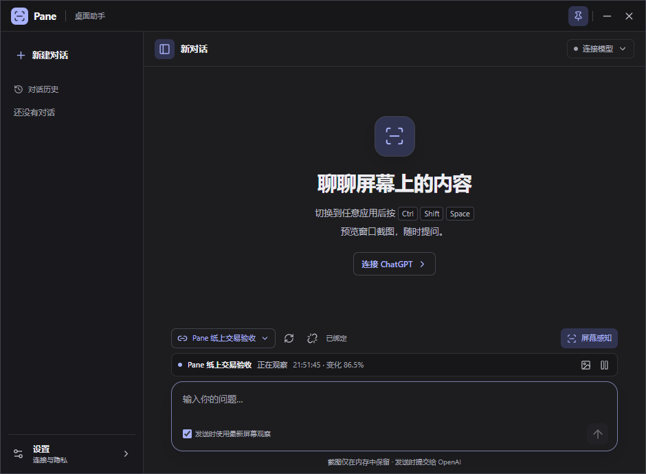

# Pane · Windows 桌面助手

Pane 是一个本地运行的悬浮窗口问答工具。用全局快捷键捕获前一个活动窗口，预览后把截图与问题一起发送。默认通过 ChatGPT 套餐连接，也可选择独立的 OpenAI API Key。

## 下载与预览

[下载最新 Windows x64 安装包](https://github.com/t0mAto1104/pane-desktop-companion/releases/latest)

| 浅色 | 深色 |
| --- | --- |
|  |  |

## 安装与使用

1. 在 Windows x64 运行 `Pane-Setup-2.1.0-x64.exe`。这个 MVP 安装包未签名。
2. 在 **设置 → 账户和模型** 选择 **使用 ChatGPT 登录**，在系统浏览器中允许使用 ChatGPT 套餐额度，再从账户返回的目录选择支持图片的模型。符合条件的账户才会获得套餐用量权限。
3. 切换到目标软件，按 **Ctrl+Shift+Space** 唤出 Pane。检查窗口名称和截图预览，然后输入问题并按 **Enter**。按 **Shift+Enter** 换行。
4. 通过输入框上方的窗口菜单绑定另一个窗口，用刷新按钮更新截图。可在预览中取消附件。用标题栏图钉切换置顶，拖动标题栏移动窗口，拖动边缘缩放。
5. 按 **Esc** 或点击隐藏按钮返回托盘。托盘菜单可以退出 Pane。在设置中可切换深色或浅色、关闭唤出时抓图、配置要禁止捕获的 `.exe` 文件名。

使用 API Key 时，在 **连接方式** 选择 **OpenAI API Key**，打开 Windows 原生输入框并输入密钥。这个模式使用独立的 OpenAI Platform 项目额度。应用会查询该项目的模型目录。发送截图时请选择支持图像输入的 Responses 模型。

## V2.1 屏幕感知

1. 在输入框上方打开 **屏幕感知**，再通过窗口菜单绑定要观察的窗口。也可以先绑定再启用。
2. 状态栏显示窗口名称、最近观察时间和变化比例。可预览观察截图，暂停或恢复监控。
3. 输入问题并发送时，Pane 会重新确认目标身份和画面状态。最新有效观察优先于同一窗口的旧手动截图。取消勾选 **发送时使用最新屏幕观察** 可仅使用文字或已手动附上的截图。
4. 同一对话、同一窗口的画面未变时，后续请求使用历史回答和「画面未变」提示。需要让模型读出先前回答未覆盖的细节时，可在观察预览中选择 **本条附上观察截图**。

| 设置 | 默认 | 范围 |
| --- | --- | --- |
| 屏幕感知 | 关闭 | 开或关 |
| 采样间隔 | 1000 毫秒 | 350–5000 毫秒 |
| 变化阈值 | 0.015（1.5%） | 0.002–0.5 |
| 最近观察数量 | 3 | 1–8 |

观察进程复用一个 WGC 会话，以 96 × 54 彩色采样在本地比较画面。确认变化后才生成 JPEG。防抖要求连续采样趋于稳定，持续变化的界面达到等待上限后可采纳当前画面。两次已记录变化之间至少相隔 1.5 秒。图片缓存在内存，另有 24 MiB 上限。只有显式打开预览时，主进程才把一张观察图片交给界面。观察标识、窗口名称和与对话的推理关联保存在内存。使用观察图片的消息在 SQLite 中以「屏幕观察」标记，消息结构延续 V1。用户发送前，观察过程没有推理调用。

监控可以在托盘后台继续运行。暂停、关闭功能、解绑、锁屏和系统挂起会释放观察会话和缓存。最小化、失效、禁止捕获或原生错误均会停止观察。窗口还原后可恢复，重新打开窗口或重启 Pane 后须重新绑定。捕获失败或画面仍在确认时，可以继续发文字。手动刷新截图仍可使用。V2.1 通过 WGC 观察像素，Windows UI Automation 不参与采集。细微文字或变化区域小于阈值时，可降低阈值或手动刷新。Windows 旧版本的 WGC 会话可能持续供应合成帧，Pane 仍按设定的间隔读样。


## 数据与权限

- Windows.Graphics.Capture 按 HWND 捕获单个窗口。助手窗口会被排除。最小化、受保护、已关闭或身份无法确认的窗口可能无法捕获，应用会在截图区域显示原因。
- 发送前可检查或取消待发送的截图。已发送的截图在内存里用于后续同一对话，退出 Pane 或达到缓存上限时清除。每次请求最多携带最近 4 张仍在内存中的截图，以及最近 60 条范围内、总计约 10 万字符的完成消息。跨重启保留消息文本、对话更新时间和已发送截图的窗口标题。截图像素仅在内存中保留。
- 对话、设置和加密的 API Key 位于 `%APPDATA%\Pane\pane.sqlite`。OAuth 凭据由 DevKit 保存在 `%APPDATA%\Pane\chatgpt`，使用 Windows DPAPI 保护。密钥和令牌由主进程与本机凭据输入框处理。
- 两种连接都使用公开的 `https://api.openai.com/v1/responses`，每次发送 `store: false` 和 `stream: true`。请求携带相关本地历史。截图和消息在发送时交由 OpenAI 处理。Pane 只提供聊天和截图界面。

## 从源码构建

目标平台为 Windows 10 x64（版本 1903 或更新）及 Windows 11 x64。需要 Node.js 24.13 或更新版本、npm、Visual Studio 2022 的 **使用 C++ 的桌面开发** 组件，以及含 C++/WinRT 头文件的 Windows SDK（构建已使用 10.0.26100）。

```powershell
npm ci --legacy-peer-deps
npm run build:native
npm run dev
```

```powershell
npm test
npm run build
npm run test:desktop
npm run dist:win
node tests/desktop.mjs --packaged
```

安装包位于 `release/Pane-Setup-2.1.0-x64.exe`。桌面测试会打开一个专用的模拟交易窗口，并向该窗口发送快捷键。它验证截图像素、刷新、绑定、多轮流式 UI、停止、重发以及 SQLite 重启恢复。AI 响应由本地测试替身提供。自动化也覆盖两种 Responses HTTP 流，以及模拟 OAuth 回调、凭据轮换和模型发现。

本次验收使用本机 Windows 构建 26300、单显示器、100% DPI。桌面测试覆盖窗口缩放、观察启停、禁止名单、窗口重开和显式发送。单元测试覆盖 DPI 变化评分。账户登录、真实图片推理、独立 Windows 10、多物理显示器及混合 DPI 实机矩阵需要在覆盖相应环境时验证。OAuth 测试可在安装包中使用有资格的账户授权，然后切到专用窗口发送一张测试截图，再追问截图中的细节。

## 官方接入与许可

OAuth 使用固定版本的 Sign in with ChatGPT DevKit。仓库内保留其源码、修改说明和许可证。随附 DevKit 采用 OpenAI 非商业许可证，本地个人 MVP 按该许可交付。商业使用需适用的书面许可。[OpenAI 官方接入指南](https://developers.openai.com/cookbook/articles/sign-in-with-chatgpt) · [DevKit 许可证](./vendor/siwc/LICENSE)
